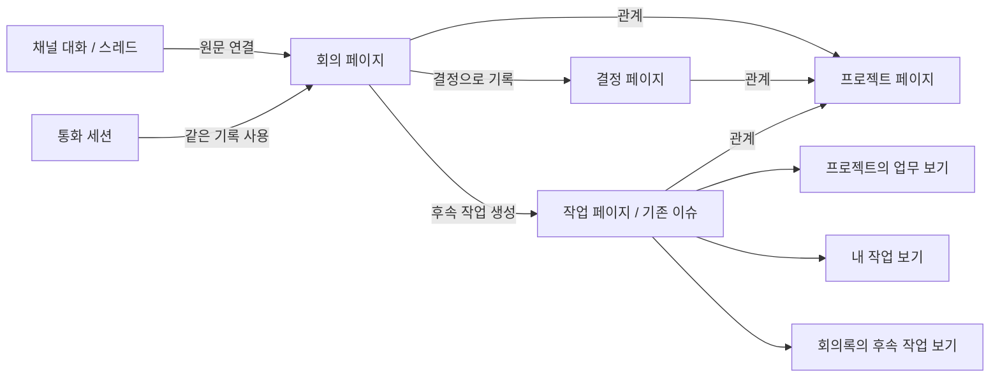

# 회의·대화·문서·데이터베이스 통합 UX 설계

2026-10-26 / 설계 검토본 v2 / 실제 제품 구현·사용자 검증 전

이 문서는 앞선 [색상·레이아웃 탐색](workspace-direction.md)을 UX 완성안으로 취급하지 않는다. 그 시안은 기능을 나열했고, 기록의 정체성·소유 위치·재사용·권한·회의 이후의 흐름을 해결하지 못했다. 아래는 이를 보완한 상호작용 계약이다. 최종 비주얼 디자인과 사용자 검증까지 끝났다는 의미가 아니다.

## 1. 제품이 사용자에게 약속할 것

**이야기한 내용을 다시 옮겨 적고 정리하는 비용을 줄이면서, 팀의 자료를 오래 찾고 활용할 수 있게 한다.**

핵심 원칙:

1. 한 기록에는 한 원본이 있다. 회의록·프로젝트·내 작업에서 같은 작업을 보고 수정한다.
2. 기록은 읽고 쓰는 페이지이면서 정렬·필터·관계로 관리할 수 있는 항목이다.
3. 사용자는 먼저 일을 한다. 데이터베이스를 설계해야만 회의를 시작할 수 있게 만들지 않는다.
4. 관련 자료를 보여주는 것과 그 자료의 접근권한을 주는 것은 다르다.
5. 저장, 업무상 확정, 다른 사람에게 공유는 서로 다른 행위다.

자연스러움은 화면의 닮은 정도가 아니라 “어디에 남았는지 이해하고 다음 행동을 할 수 있는지”로 검증한다.

## 2. 핵심 객체와 사용자 언어

| 객체 | 사용자가 이해할 의미 | 정체성·소속·수명 |
| --- | --- | --- |
| 워크스페이스 | 같이 일하는 조직/팀 | 현재 Slacord teamId 경계 유지 |
| 공간 | 함께 접근하고 관리하는 자료 영역 | 권한/운영 경계. 프로젝트와 다른 개념. 작은 팀은 기본 공간 하나로 시작 |
| 페이지 | 본문을 작성하고 열어보는 한 기록 | stable pageId. 독립 문서 또는 데이터베이스 항목. 제목/본문/댓글/버전은 열리는 곳과 무관하게 동일 |
| 데이터베이스 | 같은 종류의 기록을 모아 관리하는 곳 | UI에선 일상 명칭(회의록, 업무, 자료실). 내부 sourceId는 스키마/항목 소유, containerId는 배치 구분 |
| 보기(뷰) | 같은 기록을 목적에 맞게 보는 방법 | 원본 source 참조 + 필터/정렬/그룹/표시 속성. 목록을 복제하지 않음 |
| 프로젝트 | 달성할 목표와 관련 기록을 묶는 페이지 | 프로젝트 DB의 항목. 공간과 동일시하지 않으며 한 공간에 여러 프로젝트 가능 |
| 회의 기록 | 준비한 안건과 논의·결정·후속 작업 | 회의록 DB의 페이지. 통화 세션과 분리해 통화 전후에 계속 존재 |
| 통화 세션 | 실제 음성/영상 연결 | meetingPageId에 연결할 수 있음. 회의록 하나에 재접속/후속 세션 여러 개 가능 |
| 대화 | 채널/DM/스레드에서 오가는 메시지 | 메시지는 메시지로 유지. 필요할 때 출처 링크 또는 선택 구간 인용으로 기록에 연결 |
| 작업 | 담당자·상태·기한이 있는 실행 항목 | 기존 이슈의 ID/알림/URL을 보존하는 업무 DB 표현. 두 별도 작업을 동기화하는 UX 금지 |
| 결정 | 팀이 확정하거나 변경한 판단 | 결정 DB 페이지, 상태/결정일/관련 회의/프로젝트/대체된 결정 관계 |
| 파일 | 실제 업로드된 바이너리와 메타데이터 | stable assetId. 페이지 첨부/파일 속성은 참조이며 단순 이동으로 재업로드하지 않음 |

`회의록`·`업무`·`결정`은 고정된 별도 앱이 아니라 이해하기 쉬운 기본 데이터베이스와 템플릿이다. 사용자는 사용자 정의 속성과 뷰를 추가할 수 있다. 모든 일반 문서를 DB에 강제 편입하지는 않는다.



## 3. 사이드바는 도구 목록보다 장소와 재방문을 설명한다

```text
워크스페이스 전환
검색
받은함                  나에게 필요한 이벤트
내 작업                 내 담당 작업의 보기
즐겨찾기                페이지·DB 보기·대화 모두 고정 가능
공간: 제품팀
  시작 페이지           팀이 편집하는 페이지
  대화                   채널과 DM으로 연결
  프로젝트               프로젝트 DB
  회의록                 회의 DB
  업무                   기존 이슈를 포함한 업무 DB
  자료실                 문서·첨부를 찾는 보기
  사용자 페이지/DB       사용자가 구성하는 트리
공간 탐색 / 전체 자료    현재 공간 밖의 접근 가능한 자료
설정 / 휴지통 / 계정
```

- 프로젝트를 누르면 같은 프로젝트 페이지의 본문과 연결된 보기가 열린다. 왼쪽 공간 트리 전체를 프로젝트 전용 메뉴로 갈아끼우지 않는다.
- 대화 안 자료 탭은 필요할 때 사용자가 고정한다. 모든 채널에 빈 문서/이슈/회의 탭을 기본 생성하지 않는다.
- 프로젝트 페이지는 목표·결정·일정·업무·회의를 배치할 수 있다. 단계 1의 기본 템플릿은 아래의 순서로 제공하되 편집 가능하다.
- 문서 트리는 물리적인 소속, 프로젝트 Relation은 논리적 연결이다. 둘을 혼합해 여러 부모나 권한 상속을 암묵적으로 만들지 않는다.
- 로고는 브랜드 식별, 팀 이름은 워크스페이스 전환, 공간 이름은 현재 자료 범위다. 사용자에게 같은 역할의 전환기를 세 개 노출하지 않는다.

## 4. 대표 흐름 A — 회의 준비부터 실행 추적까지

### 준비

프로젝트 페이지의 `회의 준비` 또는 회의록 DB의 `새 회의` → 같은 회의 템플릿 사용. 현재 프로젝트 안에서 만들었으면 프로젝트 관계를 기본 입력하고, 제목·일시·참여자를 확인한다. 일반 채널에서 만들었으면 관련 채널만 연결하고 프로젝트를 임의 추측하지 않는다.

생성 직후 `회의록 / [제목]`과 `프로젝트: [이름]`을 표시한다. 본문은 안건 / 참고 자료 / 논의 / 결정 / 후속 작업으로 시작한다. 템플릿 설명은 빈 상태에서만 짧게 보이고 입력하면 사라진다. 녹음 없이 안건만 준비할 수 있다.

### 회의 중

`통화 시작`은 기존 회의 페이지와 통화 세션을 연결한다. 페이지 상단은 준비→진행 상태를 표시하고 하단 통화 제어는 이동해도 유지한다. 오른쪽 패널은 회의 대화 또는 참여자 중 하나를 보여준다. 문서와 채팅을 항상 3열로 강제하지 않는다.

발언을 메모하며 특정 문장을 `결정으로 남기기` 또는 `작업으로 만들기`로 선택한다. 문장의 본문을 파괴적으로 이동하지 않고 원문 연결을 남긴다. 작업 기본값은 프로젝트/회의 관계이며 담당자와 기한은 확인한다. 이미 연결된 문장을 다시 실행하면 `기존 작업 열기`를 먼저 제공한다.

자동 전사/요약은 선택 기능이다. 시작 전 녹음/전사 상태와 동의·보관 범위를 표시하고, AI 제안은 초안으로 남긴다. AI가 사람에게 작업을 자동 배정하거나 결정을 확정하지 않는다. 선택하지 않아도 회의 기록 흐름은 완결된다.

### 종료와 정리

통화 종료는 즉시 가능해야 한다. 담당자 미정이나 기록 미완성이 통화 종료를 막지 않는다. 종료 후 회의 기록은 `정리 중`으로 남는다. `결정 확인 · 담당자 미정 작업 · 공유 범위`를 한 화면에서 확인하고, 필요하면 나중에 정리한다.

`기록 확정`은 현재 저장된 내용을 검토한 업무상 표시다. 본문 저장 버튼이 아니다. 확정 시점/revision과 작성자를 기록하고, 이후 수정은 `확정 후 변경 있음`으로 구분한다. 알림을 보낼지는 `채널에 공유`에서 별도로 선택한다. 공유 대상이 원본을 볼 수 없다면 접근범위를 먼저 보여주고 자동 공개하지 않는다.

### 후속 작업

프로젝트 페이지에는 해당 프로젝트 관계를 가진 작업의 연결된 보기가 있다. 회의록에는 해당 회의 관계를 가진 작업만 나온다. 개인 내 작업에는 담당자가 자신인 동일 작업이 나온다. 어디서 완료해도 상태는 한 번 바뀌고, 프로젝트 완료율은 동일 원본에 대한 집계로 갱신한다.

참여하지 못한 사람은 공유된 회의 기록을 열어 `결정 → 연결된 작업 → 원래 논의` 순서로 따라갈 수 있어야 한다. 통화 녹음 전체를 들어야만 결과를 이해할 수 있게 만들지 않는다.

## 5. 대표 흐름 B — 대화에서 지식으로

메시지 메뉴 `자료로 남기기` → `새 페이지` / `기존 페이지에 연결` / `작업 만들기` 중 의도 선택. 처음부터 데이터 소스 목록을 강요하지 않는다.

- **새 페이지**: 제목 제안, 저장 위치(현재 공간의 자료실 또는 선택한 부모), 원문 링크를 표시. 작성 후 즉시 저장된다. 공개범위는 원문보다 넓어질 경우 명시적으로 확인한다.
- **기존 페이지에 연결**: 권한 있는 페이지 검색, 문서 뒤에 인용 추가 또는 관련 대화로 연결. 같은 메시지 중복 연결은 방지한다.
- **작업 만들기**: 담당자/상태/기한 + 원문 링크. 메시지에 생성된 작업의 상태를 작은 참조 카드로 표시한다.

원문이 편집되면 기록의 인용은 당시에 기록한 내용임을 표시한다. 실시간으로 본문을 몰래 덮어쓰지 않는다. 원문 삭제/접근 철회 시 일반 사용자는 내용 미리보기를 볼 수 없으며, 출처가 제거되었다는 안내와 기록의 별도 보존 정책을 따른다. 제한된 메시지의 인용을 공개 페이지로 복사하는 것은 단순 링크와 다른 공유 행위다.

## 6. 대표 흐름 C — 문서에서 데이터베이스로

### 처음에는 일반 페이지

문서를 쓰다가 `/데이터베이스` → `새로 만들기` 또는 `기존 자료 연결`. 빈 표만 던져주지 않고 회의록/업무/자료 목록 등 템플릿을 선택할 수 있다. `/표`는 단순 표이고, `/데이터베이스`는 속성과 페이지를 가진 자료 모음임을 구분한다.

### 항목은 그대로 페이지

새 행을 만들면 제목·속성과 자유로운 블록 본문을 가진 페이지가 생긴다. 행 클릭은 옆으로 열기, 필요하면 전체 페이지로 확장한다. 둘은 같은 ID이며 댓글·버전·첨부·공유 링크가 유지된다. 새 행 제목이 비어 있을 때는 임시 행이며 취소/빈 행 처리 정책을 명확히 한다.

### 기존 문서를 자료 목록으로 정리

`데이터베이스에 넣기`에서 대상과 속성을 확인한다. 제목·본문·pageId·URL·댓글·버전은 보존하고 항목의 소속을 변경한다. “목록에서만 보여주기”는 연결이지 이동이 아니다. 다른 스키마로 이동할 때 속성 매핑/보존되지 않는 값/권한 변경을 미리 보여준다. 모든 자료를 자동 평탄화하지 않는다.

### 연결된 보기

프로젝트 문서에서 `기존 자료 연결 → 업무 → 프로젝트 = 현재 페이지`. 담당자별 보드와 이번 주 목록은 같은 업무 원본을 보여준다. 셀 편집은 원본을 바꾸지만 정렬·표시 속성은 현재 보기에만 적용한다. 원본 이름과 현재 필터를 항상 확인할 수 있게 한다.

`보기 제거`는 현재 배치만 없앤다. `원본 데이터베이스 삭제`는 별도 관리 동작으로, 영향받는 연결과 복원 가능성을 보여준다. 두 동작을 같은 메뉴 라벨로 제공하지 않는다.

## 7. 기본 데이터베이스 구성과 관계

| 모음 | 기본 속성 | 주요 관계와 표현 |
| --- | --- | --- |
| 프로젝트 | 이름, 담당자, 상태, 기간 | 회의/작업/결정/자료에 관계. 완료된 작업 수/전체 작업 수 롤업, 기한 상태 수식 |
| 회의록 | 제목, 일시/시간대, 참여자, 기록 상태 | 프로젝트, 원본 채널, 결정, 후속 작업. 목록/캘린더/프로젝트별 보기 |
| 업무 | 제목, 상태, 담당자, 기한, 우선순위 | 프로젝트, 관련 회의, 원본 메시지, 참고 문서. 목록/보드/내 작업 |
| 결정 | 제목, 결정일, 책임자, 제안/확정/대체 상태 | 회의, 프로젝트, 근거 자료, 이전 결정. 대체되어도 이력 보존 |
| 자료실 | 제목, 유형, 소유자, 태그, 검토일 | 프로젝트, 관련 페이지, 파일. 목록/갤러리/검토 필요 보기 |

기본 항목은 초보자가 즉시 사용할 템플릿이다. 사용자는 속성/뷰를 확장할 수 있고 고객·채용·자산 등 임의 DB를 만들 수 있어야 한다. 고정 5개 테이블을 만들어 놓는 것을 노션 수준의 데이터베이스로 부르지 않는다.

## 8. 데이터베이스 기능별 UX 계약

| 기능 | 사용자의 조작 | 결과와 오류/권한 경계 |
| --- | --- | --- |
| 기본 속성 | 텍스트, 숫자, 선택, 다중선택, 상태, 날짜, 사람, 파일, 체크, URL 등 | 타입별 입력·비어 있음·검증. 잘못된 입력을 조용히 버리지 않음 |
| 관계 | 관련 DB 선택 후 항목 검색, 단일/복수 | 연결된 원본 페이지를 열 수 있음. 권한 없는 제목/아이콘/결과 개수 노출 금지 |
| 롤업 | 관계 → 대상 속성 → 집계 방식 | 계산 결과는 읽기 전용. 집계 경로를 설명. 접근 가능한 데이터만인지 명시; 숨긴 항목 개수 추론 금지 |
| 수식 | 속성 ID 기반 자동완성, 결과 미리보기 | 이름 변경에도 유지. 구문/타입/순환/계산 오류를 표시하고 마지막 정상 값을 최신값처럼 보이지 않음 |
| 표 | 셀 편집, 범위 선택, 복사/붙여넣기, 열 폭/고정 | 셀 저장 상태, 일괄 작업 부분 실패 목록, 키보드 이동. 긴 본문과 표 스크롤을 분리 |
| 보드 | 상태 그룹 전환, 카드 이동 | 드래그와 키보드 상태 메뉴 동등. 상태 없는 항목 그룹 보존. 이동은 원본 속성 수정 |
| 캘린더/타임라인 | 기준 날짜 속성 선택, 기간 조정 | 날짜 없는 항목 접근, 시간대/종일 구분, 날짜 편집 권한 확인 |
| 목록/갤러리 | 표시 속성·미리보기 선택 | 텍스트 정보가 썸네일 부재로 사라지지 않음 |
| 필터/정렬/그룹 | 복합 AND/OR 조건, 다중 정렬 | 현재 조건 표시. 숨은 항목이 삭제된 것으로 오인하지 않게 필터 해제 제공 |
| 개인/공유 보기 | 내 보기 저장 또는 공유 보기 수정 | 개인 임시 변경 표시, 권한 없는 공유 수정은 개인 복사로 제안 |
| 필터된 보기에서 생성 | 새 항목 | 단순 고정 관계 등 결정 가능한 조건만 기본값에 반영. OR/수식/상충 조건은 추측하지 않음. 저장 후 숨겨지면 대상 링크와 이유 제공 |
| 템플릿 | 속성 기본값 + 본문 + 연결된 보기 | `현재 페이지` 관계 필터를 생성된 새 ID에 바인딩. 기존 회의의 ID를 복사해 연결하지 않음 |
| 일괄 편집 | 현재 선택 항목만 수정 | 선택 개수/대상 범위 표시. 보이지 않는 필터 밖 항목까지 전체 선택하지 않음 |
| 속성 구조 변경 | 이름/옵션/타입/삭제 | 이름과 ID 분리. 손실 가능 변경의 영향 미리보기·확인·복구 설계. 콘텐츠 편집 권한과 분리 |
| 폼 | DB 입력 폼 생성·공유 | 응답 작성과 전체 DB 읽기 권한 분리. 외부 제출/스팸/첨부 제한 고려 |
| 버튼/자동화 | 조건과 실행 결과를 구성 | 권한 주체·중복 방지·실행 기록·실패 재시도·순환 방지. 초보자의 기본 작성 흐름에는 강제하지 않음 |
| 차트 | 집계/축/필터 선택 | 빈 값/기간/부분 권한 범위를 설명하고 원본 보기로 이동 가능 |

범위는 [기존 전체 속성·뷰 분석](../notion-analysis/02-databases-properties-formulas.md)과 연결한다. 고급 기능을 메뉴만 추가한 상태로 구현 완료 처리하지 않는다.

## 9. 저장·공유·회의 상태는 분리한다

| 대상 | 상태 | 사용자에게 보여줄 동작 |
| --- | --- | --- |
| 내용 저장 | 변경 없음 / 저장 중 / 저장됨 / 실패 / 충돌 / 오프라인 | 자동 저장. 실패는 원본 편집을 보존하며 재시도/복구, 저장되지 않은 상태에서 이동 경고 |
| 회의 기록 | 준비 / 진행 / 정리 중 / 확정 / 확정 후 변경 | 통화 종료와 기록 확정 분리. 확정은 특정 revision에 연결 |
| 통화 | 연결 중 / 연결됨 / 재연결 / 연결 실패 / 종료 | 실제 연결 상태에만 근거. 나가기는 항상 접근 가능 |
| 결정 | 제안 / 확정 / 대체 | 새로운 결정이 이전 결정을 대체해도 원문 이력 유지 |
| 작업 | 할 일 / 진행 / 검토 / 완료 | 모든 보기에서 같은 원본의 상태. 실패하면 이전 상태 복귀 및 이유 |
| 공유 | 개인 / 제한 / 공간 / 워크스페이스 | 저장 위치와 별도로 표시. 링크 삽입으로 공유 권한이 넓어지지 않음 |

## 10. 자료 관리와 찾기

검색은 페이지/메시지/파일/작업/회의를 구분하고 제목·소속·작성자·시간·검색된 본문 구간을 보여준다. 최근 항목과 즐겨찾기는 도구별로 나누지 않고 사용자 기준으로 재방문을 돕는다. 검색 결과를 열었다가 돌아가면 검색어·필터·스크롤을 복원한다.

첨부는 페이지 본문, Files 속성, 채팅에서 같은 asset 참조를 쓸 수 있지만 URL 유출 방지를 위해 매 조회마다 권한을 검사한다. 파일 링크를 지우는 것과 파일 원본을 삭제하는 것을 구분한다. 업로드 중/실패/취소/용량 제한·형식 미리보기 실패 상태를 제공한다.

문서 소유자·검토일·마지막 수정·연결된 프로젝트를 통해 오래된 자료를 찾는다. 결정이 바뀌면 관련 가이드의 검토 필요 상태를 제안하되 문서 내용을 자동 변경하지 않는다. 휴지통에는 삭제 위치/삭제자/시간/복원 경로를 표시하고 부모가 사라진 경우 복원 위치를 선택한다.

## 11. 권한과 연결의 규칙

- 페이지 A에 DB B의 보기를 넣어도 B를 읽을 권한은 생기지 않는다. 공유 전에 `받는 사람이 볼 수 없는 자료`를 작성자에게 안내한다.
- 권한 없는 사용자에게 제목/인용/관계/롤업/검색 스니펫/알림 본문으로 내용을 우회 노출하지 않는다.
- 보기 필터는 보안 경계가 아니다. 행 수준 제한은 서버 조회/검색/구독/집계에서 평가한다.
- 개인 메모를 팀 DB로 옮길 때 소속과 접근범위 변화는 명시적으로 확인한다. 보기 연결만으로는 이동하지 않는다.
- 통화 참여 권한과 회의 문서 열람 권한은 각각 확인한다. 게스트는 허용된 기록과 자료만 받는다.
- 서버 부모 검증/상속/관계 검증은 실제 구현의 선행 조건이다. 기존 문서 기능이 이를 모두 충족한다고 가정하지 않는다.

## 12. 화면 규칙과 접근성

회의 페이지는 상단 속성, 중앙 안건/논의, 하단 결정/후속 작업의 연결된 보기로 구성한다. 프로젝트 페이지는 편집 가능한 요약과 동일 업무/회의/자료의 연결된 보기로 구성한다. 페이지 상세는 DB와 다른 제품처럼 보이지 않아야 한다.

상단은 위치·공유·동작, 그 아래는 현재 자료의 보기/필터. 개인 받은함에서 프로젝트 탭을 계속 노출하던 v1 시안의 패턴은 폐기한다. 좌측은 위치, 중앙은 작성/처리, 우측은 보조 맥락이라는 역할을 유지한다.

모바일은 하나의 작업에 집중한다. 연결 자료는 전체 페이지로 열고 뒤로가기 복원. 회의 제어는 화면 하단에서 접을 수 있다. 표는 가로 스크롤과 카드형 표시 선택, 열 편집은 시트로 제공한다. 드래그 없이도 재정렬/상태 변경 가능해야 한다.

키보드 포커스, 스크린리더 헤더/셀/상태 안내, 터치 영역, 글씨 대비, reduced-motion은 컴포넌트 계약에 포함한다. 비주얼 색상/타이포/밀도는 이 흐름을 반영한 고해상도 화면으로 별도 검토하며 v1 팔레트를 확정하지 않는다.

## 13. 기존 Slacord를 연결하는 구현 경계

현재 `document-core`는 source schema/container/row page의 타입과 검증 실험이다. 서버 저장·뷰 엔진·수식 계산·실시간 갱신이 구현된 상태가 아니다. UI가 있다는 이유로 데이터 플랫폼이 있다고 보고하지 않는다.

| 영역 | 구현 제안과 이행 조건 |
| --- | --- |
| 문서 | 기존 ID/본문/부모/버전/댓글 보존, RowPage.contentId와 연결. 일반 문서도 계속 지원 |
| 기존 이슈 | 초기에는 기존 IssueEntity를 권위 있는 원본으로 두는 업무 DB 어댑터. 같은 status를 문서 DB에 따로 저장하지 않음. 사용자 속성은 issueId를 기준으로 별도 저장·원자성 검토 |
| 회의 | meetingPageId + sessionId 분리. 수기 회의록 먼저 완결, 전사/AI는 선택 기능 |
| 관계 | source/row/page/message/asset의 구분된 참조. 관계 추가·삭제 API, 역참조/원본 삭제 정책 |
| 조회 | 서버 필터/정렬/그룹/페이지네이션/ACL. 브라우저 전체 로딩 후 숨기기로 대체하지 않음 |
| 갱신 | revision 기반 충돌 감지·저장 큐·구독 무효화, 뷰 간 동일 항목 갱신. 협업 편집은 CRDT/OT 별도 설계 |
| 이관 | 기존 링크·팀 경계·자료 개수·본문 checksum·권한·버전/첨부 대조. dry-run 후 단계 이관 및 되돌림 |

이것은 검토안이지 채택된 최종 서버 아키텍처가 아니다. 특히 기존 이슈 어댑터의 속성 편집/트랜잭션과 범용 DB 권한 합성은 구현 전에 검증한다.

## 14. UX 완료 판정과 검증 상태

| 시나리오 | 통과 조건 | 현재 상태 |
| --- | --- | --- |
| 처음 가입한 팀 | DB 용어를 몰라도 회의 준비·기록·후속 작업 생성 | 설계만 완료, 실제 사용자 시험 전 |
| 회의→작업→프로젝트 | 한 번 생성된 작업의 ID/상태가 모든 보기에서 동일 | 독립 프로토타입 대상, 실서버 검증 전 |
| 관계·롤업 | 작업 완료를 바꾸면 집계가 재계산되고 관계로 원문 탐색 | 독립 프로토타입 대상, 수식/범용 엔진 전 |
| 여러 뷰 | 필터/정렬은 보기 설정, 값 편집은 원본 수정 | 제한된 표/보드 시안, 전체 뷰 기능 전 |
| 일반 문서→DB 항목 | ID/본문/버전 보존, 속성 매핑·권한 변경 확인 | 설계만 완료 |
| 공유·권한 철회 | 연결/집계/검색/알림에서 비공개 자료가 새지 않음 | 설계만 완료, 서버 인수 시험 전 |
| 실패·복구 | 저장 실패/오프라인/동시 수정/원본 삭제에서 유실 없음 | 상태 설계, 제품 통합 검증 전 |
| 모바일·접근성 | 화면 왕복·키보드·터치·포커스·스크롤 복원 | 시안 일부 검증, 보조기술/사용자 시험 전 |
| 비주얼 시스템 | 실제 데이터량·긴 제목·빈 화면·오류·밀도·라이트/다크에 일관 | 미완료, 팔레트 미확정 |

사용자 시험은 채팅 중심 사용자, 문서/자료 관리자, 처음 사용하는 팀원, 게스트 시나리오로 진행한다. 중립적인 과제(“회의 결과를 담당자에게 넘겨주세요”, “지난 결정의 근거를 찾아주세요”)를 주고 도움 없이 완료·재작성/복제 여부·저장 위치 이해·공유 범위 판단을 관찰한다. 목표 수치나 통과율은 아직 측정하지 않았다.

**기획 문서와 클릭 시안 작성만으로 UX 완성을 선언하지 않는다.** 정상 흐름뿐 아니라 데이터 정체성, 권한, 실패 복구, 실제 사용자 이해와 비주얼 검토를 모두 거쳐야 한다.

## 15. 이후 작업 순서 (v1 순서 대체)

1. 통합 객체/소유 위치/권한 계약과 대표 흐름을 검토·확정한다.
2. 회의→기록→후속 작업→DB 보기의 동일 원본 동작을 서버를 포함한 수직 기능으로 구현한다.
3. 페이지/속성/관계/보기 공통 컴포넌트를 만든 뒤 고해상도 비주얼 시스템을 적용한다. 팔레트만 먼저 전체 교체하지 않는다.
4. 기존 문서/이슈/채팅을 보존하며 연결하고 모바일·오류·권한별 시나리오를 검증한다.
5. 범용 DB 속성/뷰/수식/롤업/템플릿/폼/자동화를 확장한다. 목표 전체 범위는 유지한다.
6. 실제 사용자 관찰과 수정 후 디자인·UX 완료 범위를 명시한다.

## 근거

- [Notion: 데이터베이스의 항목은 페이지](https://www.notion.com/help/intro-to-databases)
- [Notion: 원본과 연결된 데이터베이스](https://www.notion.com/help/data-sources-and-linked-databases)
- [Notion: 관계와 롤업](https://www.notion.com/help/relations-and-rollups)
- [Notion: 데이터베이스 템플릿](https://www.notion.com/help/database-templates)
- [Notion: 업무 데이터베이스](https://www.notion.com/help/sprints)
- [Notion: 회의 기록과 저장 위치](https://www.notion.com/help/ai-meeting-notes)
- [Slack: 허들과 기록](https://slack.com/help/articles/4402059015315-Use-huddles-in-Slack)

공식 공개 자료를 참고한 자체 제품 설계다. 경쟁 제품의 비공개 내부 구현을 복원한 결과나 로그인 런타임 전체 검증 결과가 아니다.
