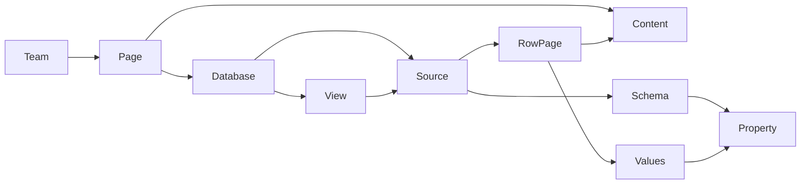

# 문서 플랫폼 아키텍처 초안

기준 커밋: `30b05ef07b2a9f52c639485ef2667eeb4690cd69`.
분류: 아래 현재 상태는 코드 관찰, 목표 구조는 Slacord 설계 제안이다. Notion의 비공개 구현을 복원했다고 주장하지 않는다.

## 현재 구현에서 확인한 점

| 영역 | 코드 근거 | 교체 시 과제 |
|---|---|---|
| 에디터 | `packages/web/src/features/document/ui/BlockEditor.tsx`가 `editor.document` 배열을 JSON 문자열로 전달 | 블록 ID·본문 스키마 버전·협업 저장 계약, 에디터 어댑터 필요 |
| 문서 저장 | `packages/server/src/modules/document/infrastructure/persistence/document.schema.ts`의 `content: string`, `plain/html/json` | 페이지 본문과 구조화 속성 값을 분리 |
| 수정 | `update-document.use-case.ts`가 기존 내용을 snapshot 후 저장, repository는 `findByIdAndUpdate` | 확인한 경로에 revision 비교가 없음. 충돌 방지·원자적 이력/이벤트 저장 설계 |
| 문서 권한 | `domain/document.entity.ts`의 문서 visibility/editPolicy, controller의 팀·열람 검사 | source/schema/row/property의 권한을 독립 평가 |
| 목록 | repository의 team 조회 및 controller의 문서 필터 | 서버 pagination/query/검색에서 권한 적용 |
| 기존 기능 | 문서 트리·댓글·첨부·버전·Confluence 변환 모듈 | 기존 ID·첨부·계층·권한·이력 보존 이관 |

문서 모듈 45개 파일을 AST로 분석한 그래프는 로컬 `graphify-out/`에 있다. 333 노드/808 edge이며 범위 밖 참조 116개와 같은 endpoint edge 병합 106개가 진단되었다. 그래프만으로 전체 호출 관계가 완전하다고 판단하지 않는다. 위 결론은 실제 소스도 확인했다.

## 모델 경계

- **Page**: 문서 identity, 부모, 제목·아이콘·커버·소유자·아카이브 상태. 일반 페이지와 행 페이지를 연결 가능한 동일 identity 체계로 취급한다.
- **Content**: 버전이 있는 블록 문서. 에디터 전용 JSON과 조회용 projection의 경계를 둔다. 협업 엔진 선택 전 원본 블록 자료를 폐기하지 않는다.
- **Database container**: 페이지 내 배치와 source/view 목록. 동일 source를 여러 컨테이너에서 연결할 수 있다.
- **Data source**: team 경계, 속성 schema, 행 소속의 정체성. source와 container 권한을 혼동하지 않는다.
- **Property**: 고정 ID와 표시 이름 분리. 타입 변경은 명시적 변환·실패 보고·rollback이 있는 schema migration이다.
- **Row page**: 본문과 속성 값, schema revision과 row revision. 제목 속성과 페이지 제목의 동기화 방식은 API 단계에서 단일 쓰기 경로로 정의한다.
- **View**: source 참조, 필터 AST, 정렬·그룹·표시 설정, 사용자/공유 소유 범위. 필터는 권한을 대체하지 않는다.

새 `document-core` 패키지는 위 개념 중 source schema, database container, row page와 속성 검증의 첫 부분만 구현했다.

## 모듈 구성

기존 NestJS/Next.js/MongoDB 기반을 유지하면서 도메인과 포트를 분리한다. 지금 DB 교체나 CRDT 라이브러리 선택을 확정하지 않는다.

| 모듈 | 책임 | 상태 |
|---|---|---|
| document-core | ID·schema·타입·검증·버전 계약 | 속성 검증 착수 |
| document-platform | page/source/schema/row/view application service와 repository | 설계 |
| document-query | filter/sort/group/pagination, 권한 있는 projection | 설계 |
| document-compute | formula parser/type checker, dependencies, rollup 재계산 | 설계 |
| document-collaboration | presence, CRDT/operation sync, checkpoint, reconnect | 선택 전 실험 필요 |
| document-automation | trigger/action/queue/idempotency/run log | 설계 |
| document-extension | versioned block/property/view/action/connector registry | 설계 |
| migration adapter | 기존 문서 읽기, 변환·ID mapping·검증·rollback | 설계 |

확장 registry는 스키마 validator, serializer, renderer, query/인덱스 지원, migration 함수를 포함해야 한다. 임의 플러그인 코드를 서버 권한으로 실행하는 계약으로 만들지 않는다. unknown extension 원본은 보존하고 편집 제한을 명시한다.

## 권한·일관성

API 쓰기는 인증→team membership→대상 source/row 소속→행/속성 write 권한→schema revision→값/참조 검사→원자적 CAS 순서로 설계한다.

- `schemaRevision`은 속성 삭제/타입 변경 후 오래된 클라이언트의 쓰기를 차단한다.
- `rowRevision`은 같은 행의 동시 갱신을 감지한다. 본문 CRDT와 구조화 데이터의 트랜잭션 경계는 별도다.
- CAS는 DB predicate에 포함해야 한다. 메모리의 비교만으로 원자성을 보장할 수 없다.
- relation의 target 존재·team·source 소속·접근권한을 서버에서 검사한다.
- 수식·rollup은 가려진 속성/행 내용을 결과·필터·정렬·집계로 누설하지 않도록 평가 정책을 정한다.
- 이벤트는 commit 이후 outbox로 배출하고 자동화는 idempotency key·origin·실행 로그·retry 정책을 가진다.
- 속성 이름 변경은 값/필터/수식의 고정 ID 참조를 유지한다. 원래 수식 표시 문자열과 resolved AST를 구분한다.

## 이관과 전환

1. 기존 문서·버전·댓글·첨부 참조의 읽기 전용 manifest 생성. 전체 건수, ID, 형식, 부모, 권한, checksum 집계.
2. `plain/html/json` 별 변환 adapter. 변환 불가능한 본문은 원본 보존과 오류 목록으로 처리한다.
3. 원본 ID↔신규 ID mapping, 블록 ID 및 멘션/첨부 참조 검증. 마이그레이션 job ID와 입력 checksum으로 재실행을 멱등하게 만든다.
4. 별도 컬렉션에서 dry-run. 건수·내용·트리 순환·부모 누락·권한·이력·첨부 대조.
5. shadow read 비교 후 팀별 feature flag 전환. source of truth를 둘로 만들지 않는다.
6. 최종 cutover에는 쓰기 동결 또는 delta replay 전략을 선택하고 체크포인트 후 검증한다.
7. rollback은 기존 데이터와 post-cutover 변경의 역변환 가능 범위를 명시한다. 신규 기능 데이터가 기존 형식에 들어가지 않으면 무손실 rollback을 주장하지 않는다.

현재는 이관 실행이나 기존 컬렉션 수정이 없다.

## 미결정과 검증 게이트

- 실시간 편집 엔진과 BlockNote 유지/교체: 한국어 IME, 오프라인 병합, undo, table/column/synced block 확장 실험 후 선택.
- schema migration, 인덱싱·값 저장·계산 materialization: 행수/속성수/동시 사용자 fixture의 부하 측정 후 선택.
- page/source/property 권한 합성 규칙과 title projection: REA 역할별 fixture 및 서버 API 인수 테스트로 확정.
- Place·button·verification 및 AI/연결 서비스의 세부 모델은 기능 지도에서 미완료로 유지.
- 모든 단계의 실제 상태는 구현/테스트/관찰을 분리해 추적한다.
