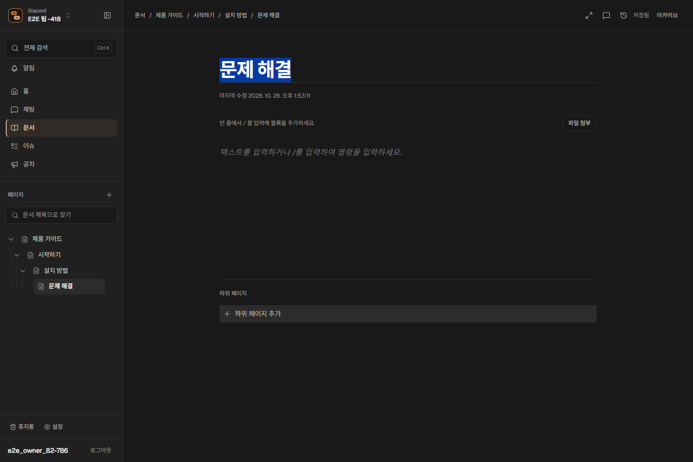
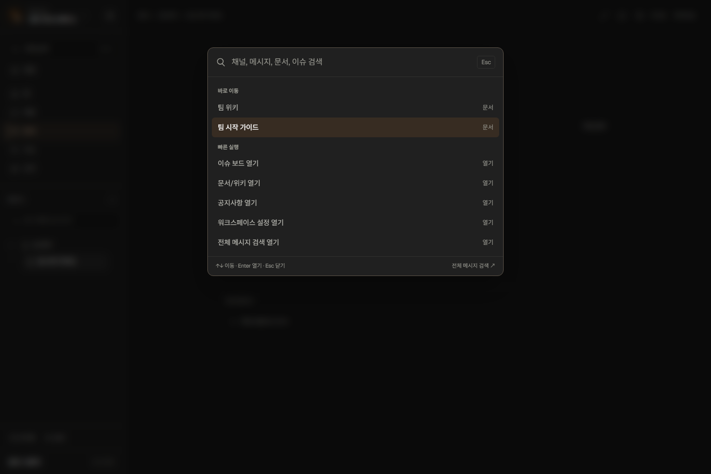
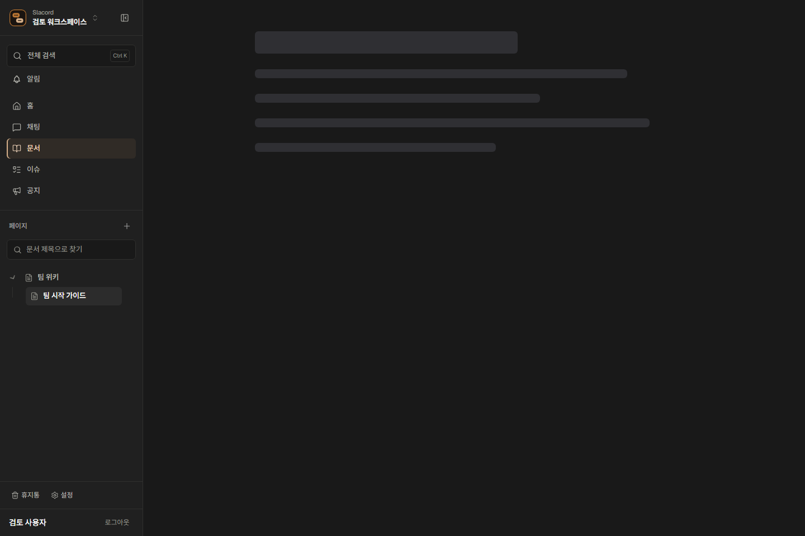

# 디자인 레퍼런스 선정과 적용 — 2026-10-26

사이트 홈페이지의 분위기가 아니라, Slacord의 협업 화면에 필요한 개별 컴포넌트와 인터랙션을 골랐다. 공개 미리보기를 실제 브라우저에서 확인하고 기존 데이터·저장·권한 흐름에 맞춰 연결했다.

## 적용한 레퍼런스

| 개별 레퍼런스 | Slacord 적용 | 적용 방식 |
| --- | --- | --- |
| [affectUI App Shell Flat](https://www.affectui.com/screens/app-shell-flat) | 영역을 이동해도 유지되는 평평한 작업 공간, 사이드바/본문 경계와 상단 정렬 | Pro 소스는 취득하지 않음. 공개 미리보기의 구조를 참고하여 기존 셸을 수정 |
| [21st의 Edwin Vakayil File Tree](https://21st.dev/@edwinvakayil/components/file-tree), [원본 Iconiq](https://iconiqui.com/navigation/file-tree) | 부모·자식 연결선, 180ms 펼침/접힘, 현재 행과 hover 액션, 좌우 방향키 접기/펼치기 | 공개 데모와 registry를 조사. 기존 Slacord 재귀 트리에 직접 구현. 원본 전체 코드나 Base UI 의존성은 가져오지 않음 |
| [21st의 Victor Command Menu](https://21st.dev/@victor-teles/components/command-menu) | 검색 대화상자 등장160ms, 선택 강조 이동120ms, 그룹별 결과와 키보드 안내 | 공개 데모의 동작을 참고해 기존 검색에 구현. 계정이 필요한 원본 컴포넌트는 취득하지 않음 |
| [affectUI Shimmer Loader](https://www.affectui.com/motion/shimmer-loader) | 문서 본문/페이지 트리의 실제 데이터 로딩 중 skeleton | 공개 [registry](https://www.affectui.com/r/shimmer-loader.json)에서 실제 코드 도입. [원본 MIT 라이선스](https://github.com/flohoeller/affectui/blob/main/LICENSE)를 `packages/web/licenses/affectui-MIT.txt`에 보존 |

Shimmer는 가짜 지연을 추가하지 않는다. 로딩 중에만 노출된다. 트리/검색은 기존 `framer-motion` 의존성을 사용하며, `prefers-reduced-motion`일 때 움직임을 제거한다. 검색의 결과 실행·포커스 복귀·모달 키보드 처리를 유지한다.

## 비교했지만 이번에 넣지 않은 후보

- Inspora의 [Discord and Liveblocks UI cards](https://inspora.design/posts/discord-and-liveblocks-ui-cards): 선택 강조와 흐르는 선 표현을 확인했다. 콘텐츠를 계속 읽는 작업 화면에 배경 애니메이션은 넣지 않았다.
- Inspora의 [Literal file tree](https://inspora.design/posts/literal-file-tree): 유기적인 나무 표현보다 실제 문서 제목·계층을 빠르게 읽을 수 있는 Iconiq 트리를 채택했다.
- Hallmark의 [Console / Benchmark](https://www.usehallmark.com/themes/console/): 문서 변경 이력·버전 비교의 후속 레퍼런스로 기록. 아직 diff 기능이나 해당 디자인을 구현한 것으로 취급하지 않는다.
- Best Free Fonts의 [Figtree](https://bestfreefonts.com/figtree): 글리프/라이선스와 표본을 확인했으나 Latin 중심이므로 한글 작업 화면의 폰트를 통째로 교체하지 않았다. 이번 변경은 기존 Geist 및 한글 fallback을 유지한다.

## 코드와 정렬 규칙

- `WorkspaceSidebarShell`, `WorkspacePageHeader`, 각 영역 header:64px 상단 기준선. 메뉴는36px 이상 행 높이와 동일한 아이콘/문자 간격.
- `DocumentWorkspace`:880px 최대 article 폭, 반응형 제목 크기, 제목/본문/하위 페이지 왼쪽 정렬.
- `DocumentTreeBranch`:계층 연결선과 애니메이션. 페이지 추가·현재 경로 펼침 유지.
- `WorkspaceSearchPalette`:검색 모션과 선택 배경 이동. 글자/입력 필드 자체에 과도한 모션 없음.
- `ShimmerLoader`, `DocumentLoading`:실제 공개 코드와 Slacord 로딩 배치 연결.
- `globals.css`:공통 토큰, 경계선, focus 표현. 외부 템플릿으로 업무 로직을 교체하지 않음.

## 확인한 화면

## 검증과 범위

웹 타입 검사 및 단위74개 통과. 브라우저13개 통과: 실제 하위 페이지 생성, 전체 영역 전환/상단 좌표, 모바일, 저장 실패/느린 응답/이동 전 저장, 손상 데이터 보호, 모션 감소·로딩·키보드, 실제 서버 이슈/검색/설정 회귀. 마지막 포커스 표현 수정 후 관련2개 재확인.

개발 서버의 오래된 CSS 캐시 때문에 새 class가 누락된 상태가 발견되었다. 기존 캐시를 로컬 `.rea`에 보관하고 새로 생성하여 실제 계산된 높이64px와 스타일 규칙 존재를 확인했다. 서버/DB와 사용자 문서는 유지했다. 운영 빌드·배포, 새 폰트 도입, Hallmark 버전 비교 화면은 이번 범위에 포함하지 않는다.
