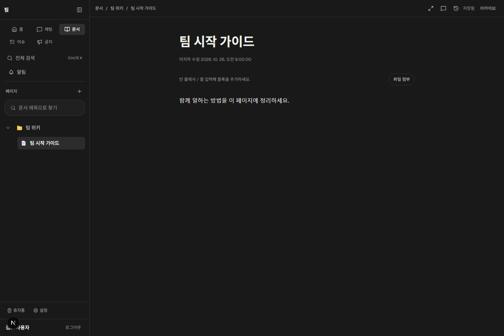
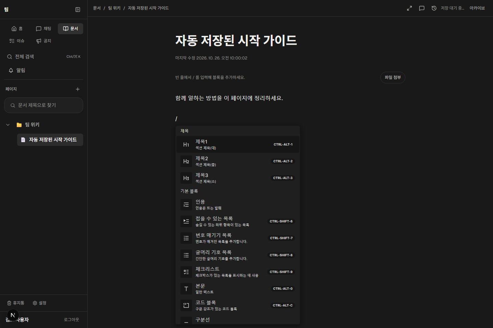

# 문서 화면 구현 확인 — 2026-10-26

문서에 들어가 바로 작성하고 자동 저장하는 흐름과 문서 영역의 통합 사이드바를 구현했다. 노션 전체 기능 구현 또는 다중 사용자 공동 편집 완료를 의미하지 않는다.

## 화면

실제 Slacord 화면의 Playwright 캡처다. 아래 이미지의 팀과 문서는 합성 API 데이터다. 실제 로컬 서버와 MongoDB 저장도 별도로 검증했다.






## 직접 확인

현재 로컬 환경은 웹 `http://127.0.0.1:3002`, 서버 `http://127.0.0.1:8082`, MongoDB `127.0.0.1:27027`이다. 앞서 열어둔 로그인된 브라우저에서 페이지를 새로고침하면 변경을 볼 수 있다. 테스트 계정의 비밀번호·쿠키는 문서에 기록하지 않는다.

1. 페이지 제목이나 본문을 클릭해서 바로 작성한다. 편집/저장 버튼은 없다.
2. 입력을 멈추면 약700ms 뒤 자동 저장한다. 오른쪽 위에서 대기/저장 중/저장됨/실패 상태를 확인한다.
3. 저장 중에도 계속 입력할 수 있다. Ctrl/⌘+S는 즉시 저장을 요청하는 선택 단축키다.
4. 빈 줄에서 `/`를 입력하면 한국어 블록 메뉴가 열린다. 제목에서 Enter를 누르면 본문으로 이동한다.
5. 왼쪽 상단에서 홈·채팅·문서·이슈·공지로 전환한다. 문서 영역에서는 채널 목록 대신 페이지 트리를 표시한다.
6. 현재 페이지의 부모가 자동으로 펼쳐지고 저장한 제목이 트리에도 반영된다. `+`로 페이지 생성 화면을 연다.
7. 사이드바를 접거나 본문을 전체 너비로 바꿀 수 있다. 모바일에서는 상단 메뉴를 펼쳐 영역과 페이지를 탐색한다.
8. 본문을 선택한 뒤 댓글 패널을 열면 선택 인용을 사용할 수 있다. 이력 패널에서 기존 버전을 확인·복원한다.

기존 프로필로 별도 실행하려면 [runtime-profiles.md](../runtime-profiles.md)를 참고한다. 해당 프로필의 기본 웹 포트는3103으로 현재 테스트 세션과 다르다. 현재 파일 저장소는 실행되지 않았으므로 파일·이미지 업로드는 사용할 수 없다.

## 저장 동작

- 문서를 열거나 에디터가 초기화되는 것만으로 저장·버전 생성을 하지 않는다.
- 요청을 직렬화하고 저장 응답을 편집기 본문에 재주입하지 않는다. 느린 응답이 최신 입력이나 커서를 되돌리지 않는다.
- 저장 중 새 입력이 생기면 최신 내용으로 이어서 저장한다. 한글 IME 조합 중에는 새 저장을 보류한다.
- 실패하면 현재 편집 내용을 유지하고 오류/재시도를 표시한다. 네트워크가 다시 연결되면 재시도한다.
- 같은 창의 일반 내부 링크 이동은 저장 성공을 기다린다. 실패하면 현재 페이지에 머문다. 새로고침/창 닫기에는 미저장 경고가 있다.
- 브라우저 뒤로가기·프로그램 이동으로 unmount할 때 저장을 시도하지만 실패 후의 복구를 보장하지 않는다. 로컬 영속 초안·다중 탭 충돌 방지·CRDT 공동 편집은 미구현이다.
- HTML/plain은 실제 편집 시 JSON 블록으로 저장한다. 지원하지 않는 가져오기 서식 보존은 별도 검증이 필요하다. 잘못된 JSON은 저장을 차단한다.
- 서버는 기존 수정 API/버전 정책을 사용한다. 자동 저장 시점마다 버전이 추가될 수 있으며 버전 병합/보존 정책은 후속 과제다.

## 검증

- 웹 TypeScript 검사 통과, 웹 단위 테스트74개 통과.
- 합성 API 브라우저 시험5개 통과: 즉시 편집·자동 저장 실패/재시도·재접속, 느린 응답 중 새 입력/편집기 유지, 이동 전 저장, 손상 JSON 차단, 모바일 읽기 전용.
- 실제 로컬 서버 브라우저 회귀3개 통과: 문서 검색/생성, 인용 댓글/답글/해결/삭제, 명령 팔레트의 영역 이동과 생성.
- 별도 실제 MongoDB 시험: 제목·본문 자동 저장→API 재조회→브라우저 새로고침 확인. 로딩만으로 버전이 생성되지 않음을 확인.
- 현재 실제 서버·DB 결과는 로컬 전용이며 운영 배포/전체 기능 검증이 아니다. 프로덕션 빌드는 이번 변경에서 수행하지 않았다.

브라우저 회귀 재현(웹/서버를 먼저 실행):

```powershell
$env:SLACORD_E2E_BASE_URL='http://127.0.0.1:3002'
$env:SLACORD_E2E_API_URL='http://127.0.0.1:8082/api'
node node_modules/playwright/cli.js test tests/e2e/document-workspace.e2e.spec.ts
node node_modules/playwright/cli.js test tests/e2e/web-app.e2e.spec.ts --grep '문서 목록|선택 인용|명령 팔레트'
```

## 주요 구현 위치

- `DocumentWorkspace.tsx`: 페이지 본문과 도구/보조 패널.
- `useDocumentAutosave.ts`, `DocumentSaveQueue.ts`: 초기화·입력·저장 대기·요청 직렬화·이동.
- `DocumentWorkspaceSidebar.tsx`: 문서 영역의 단일 사이드바와 모바일 메뉴.
- `DocumentEditorPanel.tsx`: 한국어 블록 편집, 초기화와 사용자 변경 분리.
- `tests/e2e/document-workspace.e2e.spec.ts`: 자동 저장과 레이아웃 시험.

## 남은 제품 범위

로컬 초안 복구·다중 사용자 충돌 제어·공동 편집, 아이콘/커버/레이아웃 영속 설정, 데이터베이스 속성/뷰/관계/롤업/수식, 권한 상속, 자동화/확장과 파일 저장소 연결이 남아 있다. 기존 독립 `document-core`는 아직 웹·서버에 연결하지 않았다. [전체 분석](../notion-analysis/README.md)의 미확인 영역도 유지한다.
