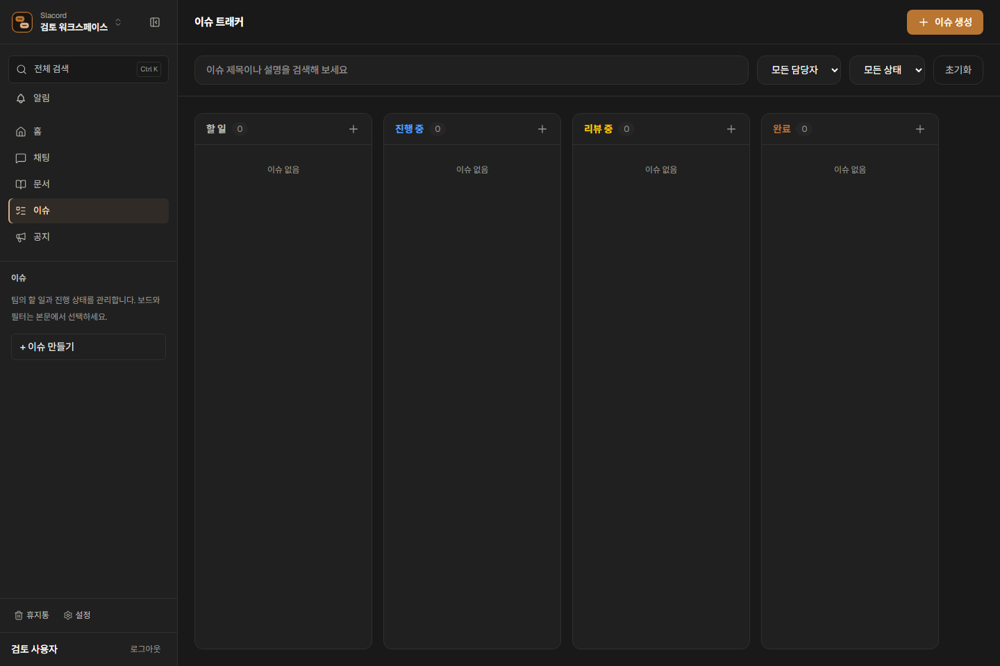

# Slacord 공통 작업 공간과 탐색 역할

Slacord는 대화 → 지식 정리 → 실행 추적 → 팀 공유를 연결하는 협업 서비스다. 문서는 그중 지식을 쌓는 작업 영역이다. 문서에 들어갈 때 별도의 제품처럼 탐색 구조를 교체하지 않는다.

## 고정되는 것과 바뀌는 것

| 위치 | 역할 | 이동 시 동작 |
| --- | --- | --- |
| 최상단 | 현재 워크스페이스 식별·전환 | 대시보드로 연결, 접기 버튼 위치 고정 |
| 공통 도구 | 전체 검색·알림 | 어느 영역에서든 동일한 위치와 동작 |
| 영역 전환 | 홈·채팅·문서·이슈·공지 | 순서 고정, 현재 영역 강조 |
| 가운데 탐색 | 현재 영역의 대상을 찾고 생성 | 채팅은 채널·DM, 문서는 검색 가능한 페이지 트리 |
| 하단 | 문서 휴지통·설정·계정 | 관리자 휴지통 권한 유지, 영역 전환과 무관하게 고정 |
| 본문 | 선택한 대상에서 실제 작업 | 대화·문서 편집·이슈 보드 등 업무에 맞는 구성 |

홈은 협업 흐름의 진입점이다. 이슈의 상태/담당자 필터와 설정의 세부 섹션은 기존 본문에 유지한다. 사이드바에 같은 제어를 중복하거나 동작하지 않는 필터를 추가하지 않는다. 이후 저장된 이슈 뷰·즐겨찾기·팀스페이스가 실제 모델로 구현되면 해당 영역의 탐색 슬롯에 추가한다.

## 구현 규칙

- 로고는 기존 `/logo.svg`를 사용하며 워크스페이스 목록으로 연결한다. 옆에는 서비스명과 실제 팀 이름을 구분해 표시한다. 서버의 임시 이름 대신 클라이언트가 조회한 팀 이름을 우선한다.
- 영역 전환은 세로 목록으로 표시한다. 각 페이지 행에는 하위 페이지 추가 링크를 제공하며 모바일과 키보드 포커스에서도 사용할 수 있다.

- `[teamId]/layout.tsx` 안의 `TeamSidebar`는 모든 영역에서 같은 `WorkspaceSidebarShell`을 렌더링한다. 경로에 따라 전체 사이드바를 교체하지 않는다.
- `getWorkspaceArea`가 현재 영역을 해석한다. 문서 휴지통은 문서 영역에 속하고, 설정은 하단에서 활성 상태를 표시한다.
- 데스크톱 폭은256px, 접으면64px이다. 라우트 전환 중 같은 인스턴스를 유지하여 접힘 상태를 보존한다. 새로고침 후 접힘 상태의 영속 저장은 구현하지 않았다.
- 모바일은 같은 탐색 DOM을 상단 메뉴로 펼친다. 영역 이동 시 닫히며 채널 생성과 DM 시작도 제공한다.
- 채널이 없어도 채팅은 `/[teamId]/channel`로 진입한다. 홈으로 잘못 되돌리지 않는다.
- 중립적인 배경·텍스트·테두리 토큰을 워크스페이스 전체에 적용한다. 기존 서비스의 강조색은 유지한다. `body:has(.workspace-shell)`로 포털 모달에도 같은 토큰을 전달한다. 마케팅/로그인 페이지에는 적용하지 않는다.
- `DocumentNavigation`은 문서 영역에서만 마운트한다. 문서 저장 이벤트에 따라 제목을 갱신하고, 다른 영역에서는 불필요한 문서 트리 요청을 하지 않는다.
- 문서 자동 저장과 내부 링크 이동 전 저장 대기는 유지한다. 공통 탐색 변경이 공동 편집이나 영속 초안 복구를 추가한 것은 아니다.

## 확인

`tests/e2e/document-workspace.e2e.spec.ts`에서 전체 영역 왕복 시 동일 DOM·메뉴 좌표·배경·활성 표시·접힘 유지, 모바일 전환/상황별 액션을 검사한다. 실제 서버의 문서/댓글/이슈/검색/설정 흐름은 `web-app.e2e.spec.ts`의 관련 시험으로 별도 검증한다.

## 하위 페이지

본문의 `하위 페이지 추가`는 현재 내용을 먼저 저장한 뒤 `parentId`를 지정해 빈 페이지를 생성하고 새 페이지 제목에 포커스를 옮긴다. 생성 중 부모 편집은 잠시 잠근다. 저장 실패 시 생성하지 않으며, 생성 실패 시 부모에 남아 다시 시도할 수 있다.

트리 행의 `＋`는 해당 부모가 명시된 제목 입력 폼으로 연결한다. 생성 후 새 페이지로 이동하고 트리를 갱신한다. 현재 페이지의 모든 조상은 트리에서 자동으로 펼쳐지며, 본문의 하위 링크와 상단 경로로 왕복한다. 깊은 단계는 들여쓰기 폭만 제한하며 데이터나 탐색 깊이는 제한하지 않는다. 부모도 계속 편집 가능한 페이지이며 폴더 전용 객체로 바꾸지 않는다.

이번 변경은 기존 `parentId` API를 연결한 생성·탐색 UX다. 페이지 이동/재정렬, 본문 `/page` 블록, 서버의 부모 권한 검증 및 접근 권한 상속은 별도 구현·검증이 필요하다. 노션의 계층 권한 정책과 동등하다는 의미는 아니다.
